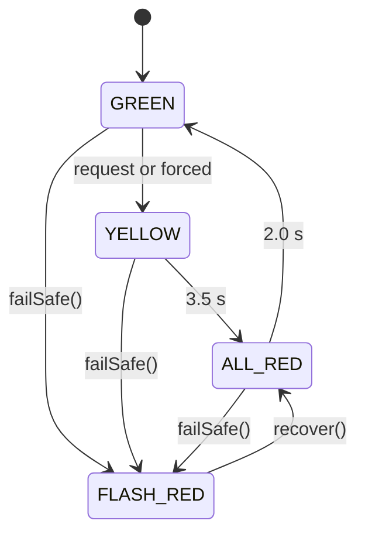

# Module 55: Schemas, JSON, Zod, Mermaid & Markdown

> The data-description and documentation languages. Schemas are executable contracts; Markdown/Mermaid are how decisions stay readable.

---

## 1. JSON & JSON Lines

| Rule | Detail |
|---|---|
| Encoding | UTF-8, no BOM, LF newlines |
| Numbers | No `NaN/Infinity`; integers for counts/money; document units in the key (`queueM`) or schema |
| Time | ISO-8601 UTC with `Z` (ms precision), or epoch ms for signed/compact fields (named `…Ms`/`ts`) |
| Keys | `camelCase` in TS-facing JSON; `snake_case` in Parquet/Spark tables; the mapping lives in one place |
| Size | Documented limits at every boundary (module 22) |
| Comments | None in JSON; use JSONC only for tsconfig-like tool configs |
| Determinism | Canonical JSON (sorted keys, no whitespace) wherever a signature or hash is computed (`helpers/canonical-json.ts`) |
| JSONL | One object per line, no trailing commas, `\n` terminated; recordings and logs |

Signing/hashing rule: **never hash or sign `JSON.stringify` of an arbitrary object**; use the canonical form.

---

## 2. Zod (TypeScript contracts)

```ts
export const LaneId = z.enum(LANES);                              // from the const array
export const EvpRequest = z.object({
  id: z.string().min(1).max(64),
  lane: LaneId,
  distanceM: z.number().finite().min(20).max(800),
  speedMps: z.number().finite().min(3).max(35),
  tRequestS: z.number().finite().nonnegative(),
  nonce: z.string().min(8).max(64),
  source: z.string().min(1).max(32),
}).strict();                                                      // reject unknown keys on signed payloads
export type EvpRequest = z.infer<typeof EvpRequest>;
```

Rules:
1. **One schema → type, validation, JSON Schema, test data.** No hand-written duplicate interfaces.
2. `.strict()` on anything signed or security-relevant; `.passthrough()` only with justification.
3. Always `.finite()` on numbers; bounds on every numeric and length on every string.
4. Use `safeParse` at boundaries and convert failures to the uniform error envelope; never expose raw zod messages with user input.
5. Version schemas (`schemaVersion: z.literal(1)`); keep N−1 readers during a migration window.
6. Refinements (`.refine`) for cross-field invariants (modal split sums to 1 ± 1e-9).
7. Fuzz test every public schema with random/malformed inputs (no throws other than controlled).
8. Export JSON Schemas to `docs/api/` via script; CI fails on drift.

---

## 3. JSON Schema (documentation/interop)

Generated, not hand-written. Draft 2020-12. `additionalProperties: false` mirrors `.strict()`. Spark `StructType`s are **generated or parity-tested** against these schemas.

---

## 4. Markdown (docs, ADRs, reports)

| Rule | Detail |
|---|---|
| Flavour | GitHub-Flavoured Markdown |
| Headings | One `#` per file; no skipped levels; sentence case or title case consistently per file |
| Line length | No hard wrap (let editors soft-wrap); one sentence per line is acceptable in ADRs for diffs |
| Lists | `-` for bullets; numbered lists only for ordered procedures |
| Tables | For comparisons/specs; keep cells short; align header separators |
| Code | Fenced with language tag (`ts`, `python`, `bash`, `sql`, `yaml`, `json`, `mermaid`, `text`) |
| Links | Relative for repo files; descriptive text (not "click here"); verified by `docs:check` |
| Callouts | `> **Note:**` / `> ⚠️` sparingly |
| Numbers | Generated sections marked `<!-- generated: do not edit -->` and produced by scripts |
| Language | Plain English, active voice, define acronyms at first use, one idea per paragraph (module 56) |
| Lint | `markdownlint` (relaxed MD013, MD033 allowing `<details>`) |

---

## 5. Mermaid

Use Mermaid for architecture, sequences, state machines and Gantt schedules inside Markdown.

| Rule | Detail |
|---|---|
| Types | `flowchart`, `sequenceDiagram`, `stateDiagram-v2`, `gantt`; avoid exotic types (renderer support varies) |
| Size | ≤ ~15 nodes per diagram; split otherwise |
| Labels | Short; quote labels with special characters; `<br/>` for line breaks |
| Directions | `LR` for pipelines, `TB` for hierarchies |
| Validation | Diagrams are **render-checked** in CI (`mmdc`); a diagram that fails to parse fails the docs gate |
| Accessibility | A one-sentence text description precedes each diagram |
| Source of truth | The Mermaid block in the doc; exported SVG/PNG only for the README header image |

State machine example (kernel):



---

## 6. Anti-Patterns

| ❌ | ✅ |
|---|---|
| `interface X {…}` duplicating a zod schema | `z.infer` |
| Signing `JSON.stringify(obj)` | Canonical JSON |
| Hand-typed JSON Schema | Generated |
| Numbers in README typed by hand | Generated from `results.json` |
| Giant unreadable Mermaid | Several focused diagrams |
| Tables with paragraph-length cells | Prose + short table |
