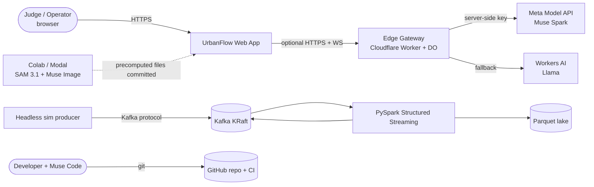
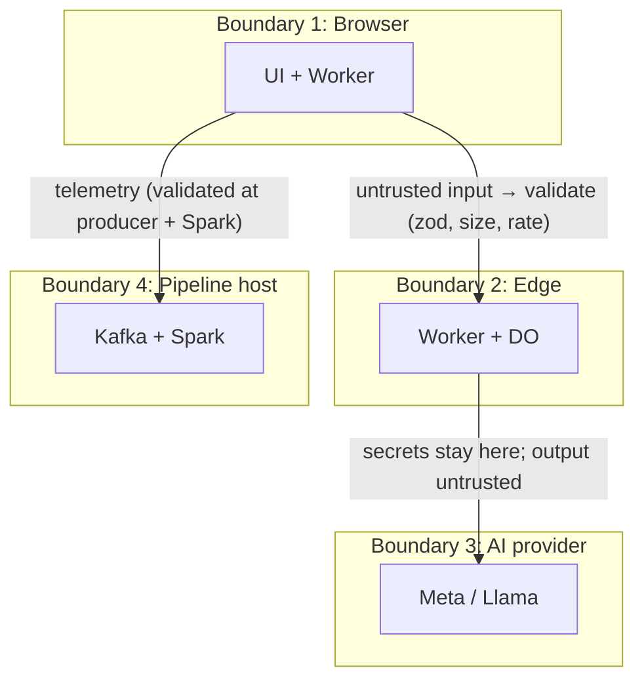
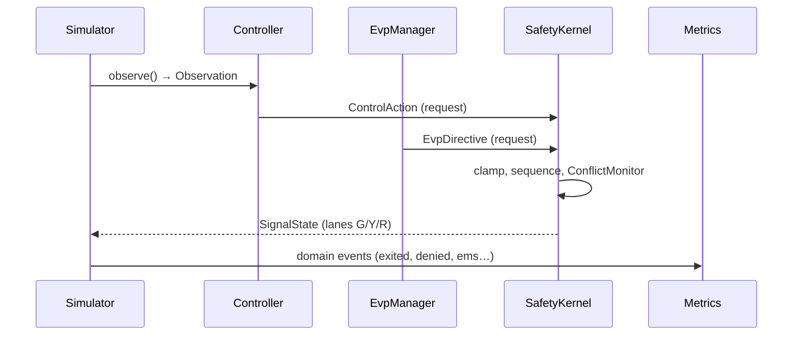
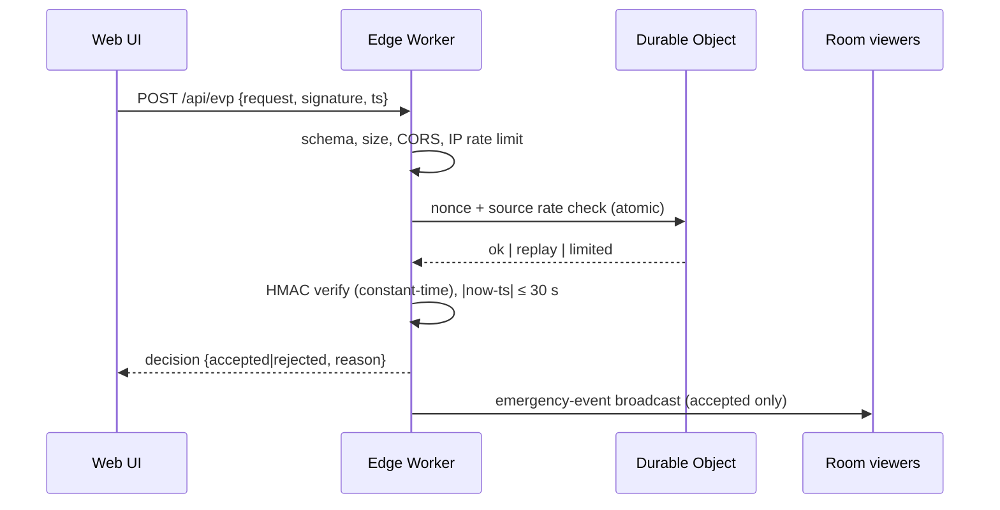
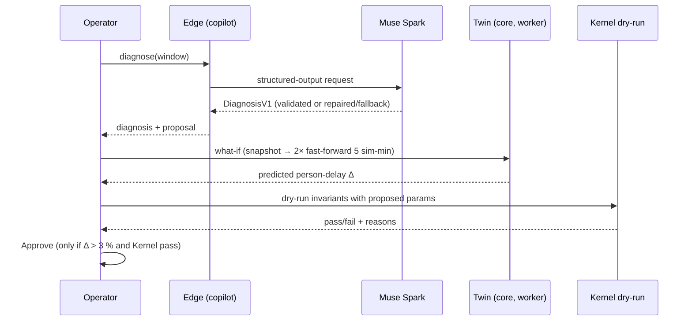

# Module 10: System Architecture

> C4-style views, trust boundaries, package dependency law, key sequences, deployment topology and the failure matrix. Decisions behind these shapes are recorded in `11_ARCHITECTURE_DECISION_RECORDS.md`.

---

## 1. Level 1 — System Context



Actors: judge/operator (browser only), developer (builds with Muse Code), external providers (Meta Model API, Workers AI). **The browser needs nothing else to work.**

---

## 2. Level 2 — Containers

```
┌──────────────────────────── BROWSER (Core mode — always works) ─────────────────────────────┐
│ Web Worker: @urbanflow/core                                                                   │
│  Simulator(seeded) → Observation → Controller(Fixed|Adaptive) ┐                              │
│                          ▲                    EvpManager ─────┤→ SafetyKernel → SignalState   │
│                          └────────── ConflictMonitor / Watchdog ┘          │                   │
│  Metrics engine ◀──────────────────────────────────────────────────────────┘                   │
│ Main thread: Canvas renderer · UI controls · uPlot charts · store · share-link codec           │
└───────────────┬───────────────────────────────────────────────┬──────────────────────────────┘
                │ telemetry / replay / EVP requests (optional)  │ copilot calls (optional)
                ▼                                               ▼
┌──────────── EDGE (Cloudflare) ──────────────┐   ┌──────────── AI LAYER (in the Worker) ───────────┐
│ Worker: router, CORS, headers, budget guard │   │ Router: Meta → Workers AI → Template            │
│ DO (SQLite): rooms, nonces, rate limits,    │   │ prompts.ts (versioned) · zod validation · cache │
│ replay store, AI counters                   │   │ circuit breaker · cost meter                    │
└───────────────┬─────────────────────────────┘   └──────────────────────────────────────────────────┘
                │ (pipeline mode only)
                ▼
┌──────────── PIPELINE (docker compose / Lite) ───────────────┐   ┌──────── VISION (offline) ────────┐
│ Kafka → PySpark SS → Parquet lake + lane-metrics + anomalies │   │ Muse Image → SAM 3.1 → polygons  │
└──────────────────────────────────────────────────────────────┘   └───────────────────────────────────┘
```

| Container | Language | Runtime | State | Failure impact |
|---|---|---|---|---|
| `core` | TypeScript | Web Worker / Node | In-memory, snapshot/restore | Fatal for the demo → hardest tested |
| `web` | TypeScript | Browser main thread | Store + URL hash + localStorage (try/catch) | Worker crash ⇒ auto-restart from last keyframe |
| `edge` | TypeScript | Cloudflare Workers | DO SQLite | Core unaffected |
| `bench` | TypeScript | Node CLI | Files (`out/*.json`) | Release gate only |
| `pipeline` | Python (+ Node producer) | Docker / Node | Kafka logs, Parquet, checkpoints | Core + Edge unaffected |
| `vision` | Python | Colab / Modal | Committed JSON/PNG | Precomputed; no live dependency |
| `evals` | TS + Python | CI / local | Fixtures, reports | Release gate only |

---

## 3. Package Dependency Law

```
                 ┌────────────┐
                 │ @urbanflow │   no DOM · no network · no timers · no Math.random · no Date.now
                 │   /core    │   exports: contracts, rng, hash, sim, control, metrics, scenarios, codecs
                 └─────▲──────┘
        ┌───────────┬──┴──────┬────────────┐
        │           │         │            │
   @urbanflow   @urbanflow  @urbanflow  pipeline/ (Node producer
      /web        /edge      /bench       imports core + kafkajs)
```

1. `core` imports **nothing** from sibling packages and no Node/DOM globals (enforced by ESLint `no-restricted-globals` + `no-restricted-imports` and a dependency-cruiser rule).
2. `web`, `edge`, `bench` may import `core`; they **never** import each other. Shared wire types live in `core`.
3. IO shells (`web/worker`, `edge`, `bench`) contain *adapters*; business rules live in `core`.
4. No circular imports (dependency-cruiser in CI).

---

## 4. Trust Boundaries



Every arrow crosses a trust boundary and requires: schema validation, size limit, rate/budget limit, timeout, uniform error shape. Model output is **untrusted input** to the system.

---

## 5. Key Sequences

### 5.1 Normal tick (inside the worker)



### 5.2 Signed EVP request via Edge



The Edge decision is **advisory to the room**; the in-browser `EvpManager` still performs its own validation and the Kernel still sequences yellow/all-red.

### 5.3 Copilot proposal verification



---

## 6. Deployment Topology (free tier)

| Artifact | Host | Notes |
|---|---|---|
| Web app (static) | Cloudflare Pages (primary), GitHub Pages (backup) | Two independent URLs; offline zip release as third |
| Edge | Cloudflare Workers + 1 DO class (SQLite-backed) | Secrets via `wrangler secret put`; `docs/DEPLOY.md` |
| Pipeline | Developer machine (Docker, ≈ 4 GB RAM) or Lite mode | Recorded replay committed to repo |
| Vision | Colab free GPU / Modal credits | Outputs committed under `vision/out/` |
| CI | GitHub Actions (public repo) | `pnpm verify`, e2e, gitleaks, audit |

No deploys after the Nov 3 evening unless fixing a showstopper; then re-run the smoke test.

---

## 7. Failure Matrix (what the user sees)

| Failure | Detection | Behaviour | Visible signal |
|---|---|---|---|
| Edge unreachable | Fetch timeout / `/api/health` | Core continues; copilot shows PRECOMPUTED example | "Edge offline — core demo unaffected" |
| Meta API 5xx/timeout/invalid JSON | Router | Retry once → Llama → Template; breaker opens 60 s | Source badge changes |
| AI budget/rate cap hit | Budget guard | Silent switch to Llama/Template | Badge + cost meter |
| Web Worker crash | `onerror` / heartbeat | Auto-restart from last keyframe | "Simulation restarted" toast |
| Kernel fault / missed heartbeat | Watchdog | `FLASH_RED` → `recover()` → baseline fixed-time | Chaos panel, measured recovery time |
| Pipeline down | Producer / UI replay | Pipeline view shows recorded replay | `REPLAY (recorded <date>)` |
| localStorage blocked | try/catch | Hints not persisted; app fine | None |
| Unsupported browser | Feature detect | Friendly message | Static explainer |
| Share link malformed | Codec fuzz-safe | Ignored; default scenario loads | Toast |

---

## 8. Architectural Fitness Functions (automated, run in CI)

| Property | Check |
|---|---|
| `core` purity | ESLint restricted globals/imports + test that bundles `core` for a Worker with no Node polyfills |
| No cycles | dependency-cruiser |
| Determinism | Same seed ⇒ same state hash (Node and 2 browsers) |
| Bundle size | `size-limit` JS ≤ 350 KB gz |
| Contract drift | Contracts snapshot test + Spark schema parity test |
| No secrets | gitleaks + built-bundle grep for env var *values* |
| Docs truth | `pnpm docs:check` (README numbers = `results.json`, links resolve) |
