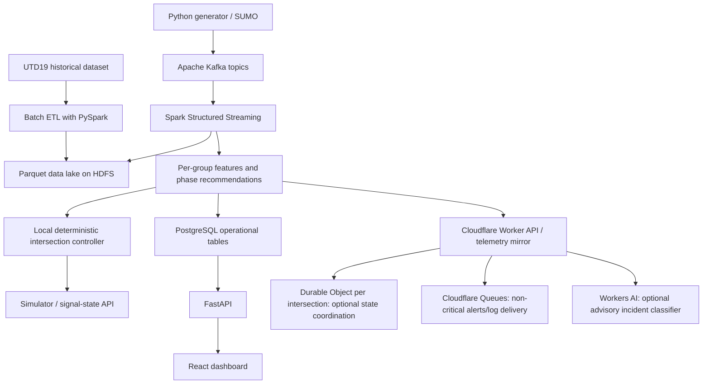

# Smart City Traffic Intelligence Platform
## Big Data Streaming, Adaptive Signal Recommendation, Emergency-Vehicle Priority, and Cloudflare Integration

**Project type:** Intermediate college Big Data project  
**Primary domain:** Smart city / urban traffic management  
**Core objective:** Demonstrate both high data volume and high data velocity while recommending safer, demand-aware traffic-signal phases at a simulated four-way intersection.  
**Implementation stance:** Simulation and decision support only. This project must not be connected to real public-road signals without authorization, certified controllers, traffic-engineering review, and a formal safety case.

---

## Executive summary

The project collects and processes traffic information for eight configurable approach or lane groups around a four-way intersection. It estimates the waiting queue on each group, detects sustained demand rather than reacting to every brief spike, ranks compatible signal phases, prevents low-demand approaches from wasting green time, and gives long-waiting approaches a fairness override. An authenticated ambulance request receives the highest scheduling priority, but the controller still completes the required safe transition sequence before granting the emergency route.

The Big Data layer combines:

- **Historical volume:** a public traffic detector dataset such as UTD19, plus larger extracts as local storage permits.
- **High-velocity stream:** a Python producer that generates or replays traffic events at controlled rates into Apache Kafka.
- **Parallel processing:** Apache Spark for batch ETL and Structured Streaming; HDFS/Hadoop for distributed historical storage and optional cluster resource management.
- **Decision engine:** deterministic, auditable rules for green-phase selection, queue thresholds, hysteresis, starvation prevention, sensor faults, and ambulance pre-emption.
- **Cloudflare integration:** Workers as an authenticated API/edge gateway, Durable Objects as a possible per-intersection coordination/state service, Queues for non-critical telemetry and alerts, and optional Workers AI for advisory incident classification. Cloudflare AI is not the safety-critical signal controller.
- **Presentation:** FastAPI, PostgreSQL, and a React dashboard, with SUMO as an optional traffic simulation and visualization environment.

The project will compare a fixed-time baseline with the adaptive recommendation logic and report throughput, end-to-end latency, queue waiting time, average delay, max red time, emergency response delay, skipped empty phases, and data correctness. All thresholds in this document are initial simulation values that must be tuned to the chosen junction layout; they are not universal traffic-engineering limits.

## 1. Problem statement

Busy urban junctions can experience highly uneven arrivals. One approach may have a long queue while another has almost no vehicles. A fixed-time signal plan can waste green time on an empty approach and may not react quickly enough to a growing queue. A naive adaptive controller has the opposite problem: if it changes signals as soon as a count fluctuates, it can switch too frequently, waste clearance time, and create unsafe or inefficient phase transitions.

The proposed platform will continuously track traffic demand across eight configured lane/approach groups. It will smooth noisy measurements, require sustained evidence before changing normal phases, select only movements allowed by a conflict map, prevent indefinite red time, and prioritize a verified ambulance request. Meanwhile, its data pipeline will demonstrate batch and streaming Big Data concepts over historical and simulated traffic events.

### 1.1 Main objectives

1. Ingest a large historical traffic dataset and preserve its provenance.
2. Generate a continuous event stream with configurable event rates and realistic bursts.
3. Store raw and cleaned data in Parquet/HDFS and process streams with Kafka and Spark.
4. Maintain a live queue estimate, waiting-time estimate, and sensor-health state for every configured group.
5. Recommend a signal phase based on demand, waiting time, fairness, and safety compatibility.
6. Avoid unnecessary green phases when a group is genuinely empty.
7. Prevent starvation by serving a group that has been red too long, even when its traffic is relatively low.
8. Pre-empt ordinary scheduling for an authenticated ambulance request using safe amber/all-red transitions.
9. Include a Cloudflare-based remote/API integration without placing a cloud AI model in the critical signal-control loop.
10. Measure throughput, latency, data quality, traffic performance, and failure behavior.

### 1.2 Project boundary and safety disclaimer

This is an academic prototype. Its output is a **recommended phase** or a **simulated signal command**, not a command for a real traffic cabinet. Real signal control depends on local traffic rules, pedestrian crossings, cyclists, turning conflicts, rail crossings, clearance intervals, controller hardware, and jurisdiction-specific standards. A real deployment would require a qualified traffic engineer, road authority approval, certified fail-safe controller integration, and validation against the actual intersection geometry. Do not connect this student prototype to live public-road signals.

## 2. What does “eight sides” mean in the implementation?

A four-way intersection has four road arms, but depending on how lanes and turns are controlled, it can contain more than eight movement groups. To make the prototype configurable, it uses **eight monitored groups, G1-G8**. Each group represents a physically defined incoming queue or a lane/movement group. The mapping must be configured for the simulated intersection rather than assuming that all eight can safely receive green at once.

Example starter mapping (adjust to the SUMO network and lane layout):

| Group | Example movement | What is measured |
|---|---|---|
| G1 | North approach: through lane group | Queue estimate, arrivals, average speed, wait time |
| G2 | North approach: protected turn lane group | Queue estimate, arrivals, average speed, wait time |
| G3 | South approach: through lane group | Same metrics |
| G4 | South approach: protected turn lane group | Same metrics |
| G5 | East approach: through lane group | Same metrics |
| G6 | East approach: protected turn lane group | Same metrics |
| G7 | West approach: through lane group | Same metrics |
| G8 | West approach: protected turn lane group | Same metrics |

This mapping is illustrative. Right turns may be separate groups, merged only when safe and lawful, or added as G9+ if the network requires it. If the user’s intended “eight sides” means eight approach-specific incoming streams rather than through/turn groups, the IDs G1-G8 can instead map to those eight streams. The controller’s **conflict matrix** is what defines safe concurrency, not the group number or queue count.

### 2.1 Sensor readings versus queue count

Keep these values separate:

- `queue_count_estimate`: estimated number of vehicles currently waiting on a group. The illustrative 50/100 thresholds apply to this metric.
- `arrival_count_window`: vehicles that arrived during a recent time window.
- `discharge_count_window`: vehicles that passed the stop line during a recent time window.
- `average_speed_kmh`: measured or estimated speed.
- `occupancy_pct`: detector occupancy, only if the source provides it or the simulator generates it.
- `waiting_seconds`: time since the group last received an adequate green service, tracked by the controller.

A count of 50 new arrivals in a short interval is not the same as 50 vehicles waiting in a queue. Do not compare those metrics using the same threshold.

## 3. Datasets and event-generation strategy

### 3.1 Historical dataset

**Recommended:** UTD19, a public multi-city traffic-detector dataset from ETH Zurich. The project website reports roughly 170 million rows, 23,541 detectors, 40 cities, and data generally aggregated at 3-5 minute intervals. Access requires registration and agreement to the dataset conditions. Use the site and published paper as the authoritative source for access, schema, and citation.

- Dataset: https://utd19.ethz.ch/
- ETH research-data record: https://www.research-collection.ethz.ch/entities/researchdata/bfb14ee7-82c8-4357-a293-3bf18d8f93f9
- Published paper referenced by the dataset record: https://doi.org/10.1038/s41598-019-51539-5

UTD19 is suitable for historical volume and traffic-pattern analysis. It is not a live feed from Ahmedabad, and its detector values should not be described as current traffic in the student’s city.

**Smaller model-development option:** METR-LA can be used to validate time-series forecasting before processing the larger dataset. The project does not require the full UTD19 dataset on day one; begin with a sample and scale up after the pipeline works.

### 3.2 Live stream simulator

Implement a Python producer with two modes:

1. **Synthetic mode:** generate configurable arrivals, queue growth, speeds, lane occupancy, random variability, rush-hour bursts, sensor outages, and emergency-vehicle requests.
2. **Historical replay mode:** read historic detector data, map its fields to the project schema, and replay the records faster or slower than wall-clock time. Mark every event with `source="historical_replay"`.

The simulator should include reproducible random seeds, pause/resume, target events per second (EPS), burst duration, selected group, and scenario presets (balanced traffic, one saturated approach, empty approaches, sensor outage, ambulance approaching, multiple demand spikes).

### 3.3 Optional traffic simulation

Use Eclipse SUMO (Simulation of Urban MObility) to model vehicle movements, road lanes, routes, intersections, traffic lights, and emergency vehicles. SUMO can make the demo more convincing because queued vehicles and the active phase can be visualized. Its emergency-vehicle documentation describes emergency vehicle classes and blue-light behavior. The project should still keep its own priority and phase state machine explicit and testable.

- SUMO documentation: https://sumo.dlr.de/docs/
- Emergency-vehicle simulation: https://sumo.dlr.de/docs/Simulation/Emergency.html

### 3.4 Event schema

A normalized event schema for Kafka can look like this:

```json
{
  "event_id": "evt-000001",
  "event_time": "2026-10-24T09:15:00Z",
  "intersection_id": "junction-01",
  "group_id": "G1",
  "queue_count_estimate": 56,
  "arrival_count_window": 8,
  "discharge_count_window": 4,
  "average_speed_kmh": 12.5,
  "occupancy_pct": 74.0,
  "sensor_status": "healthy",
  "emergency_request": false,
  "emergency_vehicle_id": null,
  "source": "simulated"
}
```

The numbers are illustrative. Historical sources may not provide all fields. Only fill fields when measured or simulated; use `null` and explicit sensor state for unavailable data instead of inventing a reading.

An emergency request should be represented as a separate, authenticated control event with a unique ID, vehicle type, requested group/route, event time, source identity, expiry, and verification result. Do not infer an ambulance solely from a free-text payload or an unverified camera label.

## 4. Architecture and division of responsibility

### 4.1 Logical flow



### 4.2 Responsibilities

| Component | Responsibility | Not responsible for |
|---|---|---|
| Python / SUMO | Create or replay events and simulate vehicles | Proving a system can operate real road hardware |
| Kafka | Buffer and distribute event streams | Computing the final safe signal phase by itself |
| Spark Structured Streaming | Parse events, use event-time windows, aggregate features, publish analytics | Acting as a certified traffic controller |
| HDFS / Hadoop | Distributed storage and batch processing of historical data | Ultra-low-latency signal switching |
| Deterministic decision engine | Evaluate queues, phase compatibility, timers, fairness, emergency priority, and fallback states | Machine-learning guesses about signal safety |
| Cloudflare Workers | Authenticated API gateway, telemetry ingress, remote status endpoints | Replacing local fail-safe controller behavior over the public internet |
| Durable Objects | Optional per-intersection shared state/coordination and persistent state | Replacing the actual certified controller or conflict interlocks |
| Cloudflare Workers AI | Optional advisory classification of incidents or summaries | Direct, unverified, safety-critical signal commands |
| PostgreSQL | Queryable current state and recent decisions | Main archive for all raw high-volume events |
| Parquet/HDFS | Long-term analytical archive | Instant dashboard sessions by itself |
| React dashboard | Visualize state, controls, metrics, and audit history | Acting as the source of truth for signal safety |

### 4.3 Kafka topics

Suggested topics:

- `traffic.raw.events` - detector readings and simulated observations.
- `traffic.normalized.events` - schema-normalized events after validation.
- `traffic.group.metrics` - per-group rolling metrics.
- `traffic.phase.recommendations` - recommended phase, reason, score, and expiry.
- `traffic.emergency.requests` - authenticated emergency pre-emption requests.
- `traffic.sensor.health` - sensor missing/stale/fault reports.
- `traffic.audit.events` - decisions, overrides, rejected requests, and recovery actions.

Use a stable message key such as `intersection_id + group_id` where ordering for a group matters. Partitioning and key design should be tested: more partitions can increase parallelism, but events that must be ordered per intersection need consistent routing and explicit single-controller ownership. Do not permit multiple independent consumers to issue conflicting signal commands for the same junction.

## 5. Big Data: Hadoop, HDFS, Spark, and parallel processing

The project should demonstrate both a high-volume batch path and a low-latency streaming path.

### 5.1 HDFS and Hadoop

- **HDFS (Hadoop Distributed File System):** stores large raw and cleaned historical files across data nodes. The NameNode maintains metadata; DataNodes store file blocks. HDFS is useful for large-scale historical data and batch analytics, not for each tiny signal decision.
- **Hadoop YARN:** optional cluster resource management if Spark runs on a Hadoop cluster.
- **MapReduce:** optional batch job for an example such as total traffic count by city/hour or detector. It is useful as an educational Hadoop component, but it is not required for the live control loop.
- **Spark:** preferred for the project’s batch ETL and streaming feature calculation. Its Structured Streaming integration supports reading from Kafka. Batch jobs can parallelize cleaning and aggregation across files/partitions.
- **Parquet:** columnar format to reduce repeated CSV parsing and allow analytical scans to read only needed columns.

### 5.2 Practical implementation profile

**Recommended local profile:** Docker Compose with Kafka, Spark in local mode, PostgreSQL, FastAPI, React, and a small HDFS configuration only if your laptop can run it comfortably. A single-node local profile validates integration but is not proof of distributed scaling.

**Cluster demonstration profile:** multiple Kafka partitions, Spark executors, multiple HDFS DataNodes, and YARN if required. Run controlled experiments and document the actual machine and configuration. Never claim distributed hardware scale based only on a single process.

### 5.3 Parallelism experiments

Compare, one variable at a time:

1. Kafka topic with 1 versus 3 versus 6 partitions.
2. Spark local execution with different executor/task settings (or a small multi-worker cluster).
3. CSV versus Parquet for a historical aggregation workload.
4. Small sample versus a larger historical extract.
5. Normal event rate versus burst traffic.

Measure input EPS, output EPS, batch duration, end-to-end latency, CPU, memory, and lag. Partition count should be chosen based on the workload and consumer parallelism, not just made as large as possible.

### 5.4 Cloudflare’s role relative to Hadoop

Cloudflare and Hadoop solve different problems. HDFS/Spark serve the high-volume data lake and analytics. Cloudflare Workers/Queues/AI are an optional edge/API layer for remote state, event forwarding, alerting, and advisory inference. Do not send every raw record to Workers AI or wait for an AI response before every normal signal change.

## 6. Eight-group signal model and safety configuration

### 6.1 Configuration model

Each group should have:

- `group_id` and description;
- approach/lane geometry and permitted movements;
- queue sensor/source ID;
- `queue_count_estimate` and confidence/quality;
- current red waiting time;
- current and recent arrival rates;
- saturation/capacity estimate;
- health state (`healthy`, `stale`, `failed`, `unknown`);
- groups it conflicts with;
- any emergency route relationship.

The intersection configuration also defines legal phases, phase transitions, minimum and maximum green, amber, all-red clearance, pedestrian constraints, sensor timeouts, priority policy, and safe fallback timing. These values must be parameters, not hard-coded assumptions.

### 6.2 Conflict matrix

A **conflict matrix** lists which groups cannot receive green simultaneously. This matrix is specific to the exact junction geometry. The phase planner may select only phase sets approved by that matrix and the configured movement rules.

Example for a simplified protected-movement intersection:

- `PHASE_NS_THROUGH = {north_through, south_through}` if these movements are compatible in the modeled geometry.
- `PHASE_EW_THROUGH = {east_through, west_through}` if compatible.
- Protected left-turn phases may need to run separately.
- Pedestrian/cyclist movements and permissive turns must be represented in the full conflict model where they exist.

Do not assume that all eight monitored groups can turn green in parallel. Parallel processing in Kafka/Spark refers to data processing; simultaneous physical green indications are allowed only for non-conflicting traffic movements.

### 6.3 Illustrative timing defaults for simulation only

| Parameter | Starter value | Purpose |
|---|---:|---|
| Sensor update interval | 1 second | Refresh queue and health estimates |
| Decision evaluation interval | 1 second | Evaluate updated demand without instantly changing phase |
| Smoothing window | 3 readings | Dampen noisy counts |
| Normal green minimum | 10-15 seconds | Stop rapid phase churn; choose one value per test scenario |
| Normal green maximum | 45-60 seconds | Prevent one phase from monopolizing the junction |
| Amber clearance | 3-5 seconds | Example only; actual value is engineering/jurisdiction dependent |
| All-red clearance | 1-2 seconds | Example only; must be set by safety engineering for the simulation/network |
| Demand confirmation | 2 consecutive decision windows | Avoid switching on one brief spike |
| Standard trigger | 50 waiting vehicles | Illustrative prototype threshold; tune to lane capacity |
| Severe congestion trigger | 100 waiting vehicles | Illustrative urgency trigger; tune and test with queue storage |
| Maximum-red fairness timer | 90-120 seconds | Example starvation-prevention target, not a universal rule |
| Stale sensor timeout | 3-5 seconds | Enter sensor-quality handling; do not treat stale data as zero |

These are only initial simulation settings. Queue counts of 50 or 100 may be unrealistic for a short lane and can exceed its storage. Calibrate thresholds to road length, number of lanes, vehicle length, queue capacity, and sensor behavior. Use a capacity ratio such as `queue_count / estimated_queue_capacity` alongside absolute count.

## 7. Adaptive signal decision logic

The scheduler should be deterministic, explainable, and traceable. Each decision should store its inputs, selected phase, rejected alternatives, reason codes, timer state, and algorithm version.

### 7.1 Step A: validate and smooth the measurements

1. Validate `event_id`, timestamp, intersection/group ID, data types, and plausible ranges.
2. Deduplicate by `event_id` or `(sensor_id, event_time, sequence)`.
3. Check sensor health and timestamp freshness.
4. If a reading is missing or stale, mark it `UNKNOWN` or `STALE`; do not silently replace it with zero.
5. Smooth short-term queue noise, for example with a median of the latest 3 queue estimates or an exponentially weighted moving average (EWMA).
6. Keep observed queue, smoothed queue, arrivals, discharge, and waiting time as separate variables.

One possible EWMA is:

`smoothed_queue[t] = alpha * queue[t] + (1 - alpha) * smoothed_queue[t-1]`

A prototype can start with `alpha = 0.5`. Tune it through scenarios rather than treating it as a universal optimum.

### 7.2 Step B: detect sustained demand with hysteresis

The aim is to avoid switching phases every time a count crosses a threshold.

- If smoothed queue is at least 50 vehicles in **two consecutive decision windows**, mark the group `HIGH_DEMAND`.
- If queue is at least 100 in one valid sample, mark it `SEVERE_DEMAND`, but do not skip phase-safety rules or mandatory minimum/clearance intervals.
- Use a lower exit threshold than entry threshold (for example, enter high demand at 50 and clear high demand only after the estimate falls below 35 for two windows). This is hysteresis.
- Consider `queue / capacity` as well as raw count. A short lane should reach high urgency based on capacity ratio even if it cannot physically hold 50 vehicles.
- Optional arrival-rate acceleration can raise urgency when the queue is growing quickly.

The 50/100 figures are starting points requested for the prototype. They must be configurable and tested against realistic lane capacity; they must not be copied to a real junction without traffic-engineering validation.

### 7.3 Step C: score legal candidate phases

Only evaluate candidate phases that are compatible with the current intersection conflict matrix. For each candidate phase `p`, calculate demand score from the groups served by that phase. A sample score for demonstration is:

`score(p) = 0.45 * queue_pressure + 0.25 * normalized_wait + 0.20 * arrival_pressure + 0.10 * starvation_bonus`

where each term is normalized to a 0-1 range. `queue_pressure` can combine absolute queue and `queue/capacity`; `arrival_pressure` indicates incoming demand; `starvation_bonus` increases with red wait. Weights should be configurable and evaluated against a fixed-time baseline. These weights are examples, not validated traffic-engineering weights.

Additional constraints:

- Never select a conflicting phase.
- Do not change normal phases before minimum green is complete, except under a configured and safe emergency pre-emption policy.
- Do not exceed maximum green indefinitely just because the current queue is high; serve other eligible movements at the next safe transition.
- Apply amber and all-red clearance before granting the next conflicting green.
- If sensor confidence is poor, reduce adaptive behavior and use a safe predefined plan.

### 7.4 Step D: skip empty or low-demand groups without causing starvation

This addresses the requirement that a group with very little traffic should not receive green time unnecessarily.

- If a group has a reliable queue estimate of zero or below a small configured threshold (for example, fewer than 2 waiting vehicles) and has no emergency request, it may be skipped in the normal phase queue.
- Do not make it permanently ineligible. Update its red-wait timer continuously.
- When its red wait exceeds `MAX_RED_WAIT`, elevate its fairness priority and schedule the next safe compatible minimum-green service, even if its queue is low.
- If the sensor is unknown/stale, it is **not** considered empty; use sensor fault logic and a fallback plan.
- If all groups are empty, use a configured low-demand/rest state from the simulation plan, continue health monitoring, and do not cycle every phase unnecessarily.

### 7.5 Step E: prevent “changing every 10 seconds”

Use a combination of controls:

1. Minimum-green timer.
2. Maximum-green timer.
3. Two-window demand confirmation / hysteresis.
4. Phase score margin: switch only when the next legal phase is sufficiently more urgent, unless the maximum-red or emergency rule applies.
5. Amber and all-red clearance states.
6. A phase-transition lock so a second request cannot interrupt the clearance sequence.
7. Minimum service and fairness logic for low-volume groups.

A high count is a reason to raise priority, not permission to flip the light immediately.

### 7.6 Step F: fairness / long-red rule

A traffic group that has waited too long must not be ignored just because another approach repeatedly has a larger queue. Use `max_red_wait` or a weighted starvation bonus. When the red timer exceeds the configured maximum, place an eligible compatible phase at the top of the normal queue and give it a minimum green on the next safe transition. If multiple groups have crossed the limit, use the longest-red group first, subject to phase compatibility and pedestrian/emergency constraints.

If a group has no vehicles but is waiting a long time, a truly empty group need not receive a full normal phase solely because a timer expired. Instead, make a short sensor verification / request check and only serve it if occupancy appears, an external call exists, or the policy explicitly requires periodic minimum service. In the user’s desired model, a waiting group with even a small real queue should not be starved.

## 8. Ambulance and emergency-vehicle priority

Emergency priority is the highest scheduling priority. However, “immediate” means **pre-empt the normal queue and transition as quickly as safely permitted**, not jump directly from a conflicting green to a new green.

### 8.1 Request validation

An emergency request should include:

- unique request ID and timestamp;
- authenticated vehicle/transponder identity or trusted simulation flag;
- emergency class (ambulance, fire, police, if enabled);
- approach/lane group and planned route through the intersection;
- estimated arrival time or distance, if available;
- expiration time and replay-protection nonce/sequence;
- verification status and source.

For the college demo, the UI or SUMO simulation can create a signed/mock authenticated request. Clearly label it as simulated. In a real system, a trusted vehicle-to-infrastructure interface or authorized emergency-services integration is needed; raw camera classification alone should not open the intersection.

### 8.2 Priority order

1. Active fail-safe state or controller fault handling.
2. Verified emergency pre-emption request with a valid route.
3. Safety clearance / conflict constraints needed to transition.
4. Maximum-red fairness for starved approaches.
5. Normal demand score (queue, arrival pressure, wait time).
6. Idle/low-demand behavior.

The safety clearance is not a competing “priority”; it is a mandatory constraint throughout all priorities.

### 8.3 Emergency transition sequence

1. Validate the request and route; reject expired or duplicate requests.
2. Determine which existing movements conflict with the ambulance path.
3. Stop accepting normal phase changes for the junction and enter the emergency-pre-emption state machine.
4. If a conflicting green is active, end it using the configured safe amber transition.
5. Apply the configured all-red clearance and verify no incompatible movement remains green.
6. Grant the protected phase serving the ambulance route.
7. Hold it according to the configured rules until the ambulance has passed the stop line / clear-zone detector, or the request expires with a verified route state.
8. Release emergency mode, record the event, and return to normal scheduling with a recovery rule that prevents other approaches being starved.

Do not force an abrupt red-to-green transition, even for an ambulance. Emergency priority must be bounded by interlocks, vehicle conflict geometry, and a safe clearance path.

### 8.4 Multiple emergency requests

If multiple valid requests are present, rank them by conflict with the current phase, estimated time to arrival, route feasibility, request age, and configured emergency class policy. Avoid serving an emergency route that does not match the verified approach. Log every accepted, delayed, or rejected request with a reason.

### 8.5 Failure cases

- Invalid or expired request: reject and audit.
- Sensor for emergency approach is down: rely only on the trusted request and the configured fail-safe route rules; do not infer the queue as zero.
- Route cannot be cleared safely: maintain the safe state, raise an alert, and follow the configured controller fallback.
- Cloud/network outage: continue the local deterministic controller; never wait indefinitely for Cloudflare or an AI response.

## 9. Cloudflare integration: what it does and what it does not do

“Cloudflare decision model” can be implemented as a Cloudflare-based decision service, but Cloudflare is not itself a traffic-signal policy. The signal decision remains an explicit deterministic rule engine. The recommended use is to add a protected remote integration for telemetry, per-intersection coordination, alert forwarding, and optional advisory AI.

### 9.1 Recommended Cloudflare components

- **Cloudflare Worker:** remote API gateway that authenticates status updates, validates payloads, forwards telemetry, rate-limits client requests, and exposes the latest recommended phase to authorized viewers.
- **Durable Object per intersection:** optional stateful coordinator that stores recent snapshots, tracks request IDs, coordinates remote clients, and prevents race conditions between remote recommendation requests. Durable Objects are stateful, uniquely identified and provide attached storage; they are suitable for coordination, but do not replace a local traffic-signal controller.
- **Cloudflare Queues:** buffer non-critical alerts, audit notifications, status snapshots, or analytics exports for asynchronous consumers. Do not put an emergency transition behind an unbounded asynchronous queue.
- **Workers AI (optional):** classify an incident description or perform advisory camera-event classification if the model, input, latency, accuracy, and costs have been evaluated. It may flag “possible ambulance” or “possible stopped vehicle” for verification, but a model prediction alone must not issue a signal command.
- **R2 (optional):** store selected dashboard exports, scenario reports, or non-sensitive artifacts. Keep raw vehicle-location data governed by the project’s data policy.

Docs:
- Workers overview: https://developers.cloudflare.com/workers/
- Durable Objects: https://developers.cloudflare.com/durable-objects/concepts/what-are-durable-objects/
- Durable Objects best practices: https://developers.cloudflare.com/durable-objects/best-practices/rules-of-durable-objects/
- Queues: https://developers.cloudflare.com/queues/get-started/
- Workers AI: https://developers.cloudflare.com/ai/

### 9.2 Recommended placement of decisions

**Primary and safest student architecture:** the phase decision engine runs locally beside the simulator/controller adapter. Cloudflare receives mirrored telemetry and serves remote dashboard/API functionality. It can optionally return an advisory signal recommendation, but the local engine validates the recommendation against the conflict matrix, timer constraints, current phase, and emergency requests.

Do not route the real-time decision loop through a remote AI model. Cloud/network delays, retries, service quotas, stale state, and model uncertainty make that unsuitable as the only safety controller.

### 9.3 Cloudflare request example

A dashboard may call an endpoint such as:

`GET /api/intersections/junction-01/recommendation`

Example response:

```json
{
  "intersection_id": "junction-01",
  "recommended_phase": "PHASE_NS_THROUGH",
  "decision_type": "normal_adaptive",
  "reason_codes": ["QUEUE_HIGH_G1", "WAIT_WEIGHT_G3"],
  "valid_until": "2026-10-24T09:15:03Z",
  "controller_mode": "SIMULATION_ONLY",
  "requires_local_validation": true
}
```

The response is illustrative. It is a recommendation and short-lived snapshot, not an actuator command. The local controller must reject stale, conflicting, unauthenticated, or invalid recommendations.

## 10. Decision-engine pseudocode

```text
EVERY evaluation interval:
    read the newest measurements for G1..G8
    validate timestamps, schema, event IDs, and sensor health
    update queue smoothing, arrival rates, wait timers, and capacity ratios

    if controller fault or critical configuration invalid:
        enter configured safe fallback; raise alert; do not issue adaptive phase changes
        continue

    if a new emergency request exists:
        authenticate request and validate route and expiry
        if invalid:
            reject request; record audit reason
        else:
            enter EMERGENCY_PREEMPT state
            finish required amber/all-red clearance
            serve only a compatible protected phase for the verified route
            hold until trusted clear/passed condition or safe timeout policy
            log event and recover with fairness-aware scheduling
            continue

    update HIGH_DEMAND when queue >= 50 for 2 consecutive valid windows
    update SEVERE_DEMAND when queue >= 100 in one valid window
    clear HIGH_DEMAND only below the lower exit threshold for 2 windows

    if current green has not reached minimum green:
        keep current phase unless a permitted emergency transition is required
        continue

    generate legal candidate phases from the configured conflict matrix
    exclude phases that conflict with active movements
    mark reliable near-empty groups as skippable for normal demand scheduling
    boost groups whose red wait exceeded MAX_RED_WAIT
    score candidates by queue pressure + arrival pressure + waiting time + fairness

    if active phase reached max green or a legal alternative has enough score margin:
        choose the highest-scoring legal phase with fairness tie-break
        execute amber -> all-red -> next-green state sequence
    else:
        keep current phase

    publish metrics, recommendation, selected reason codes, and audit record
```

The 50/100 conditions raise demand priority; they never bypass phase compatibility or transition clearance.

## 11. Signal-controller state machine

Use explicit states rather than a single variable that changes red/green directly.

| State | Meaning | Allowed next states |
|---|---|---|
| `INITIALIZING` | Load configuration and validate sensors | `NORMAL_GREEN`, `SAFE_FALLBACK`, `FAULT` |
| `NORMAL_GREEN` | Current legal phase active | `AMBER_CLEARANCE`, `EMERGENCY_PREEMPT`, `SAFE_FALLBACK`, `FAULT` |
| `AMBER_CLEARANCE` | End current green safely | `ALL_RED_CLEARANCE`, `FAULT` |
| `ALL_RED_CLEARANCE` | Configured conflict-clearance interval | `NEXT_GREEN`, `EMERGENCY_GREEN`, `SAFE_FALLBACK`, `FAULT` |
| `NEXT_GREEN` | Start the selected normal phase | `NORMAL_GREEN`, `FAULT` |
| `EMERGENCY_PREEMPT` | Validate and prioritize emergency route | `AMBER_CLEARANCE`, `ALL_RED_CLEARANCE`, `FAULT` |
| `EMERGENCY_GREEN` | Protected emergency route active | `RECOVERY`, `FAULT` |
| `RECOVERY` | Re-enter normal schedule with fairness | `NORMAL_GREEN`, `FAULT` |
| `SAFE_FALLBACK` | Preconfigured safe response to stale data/service fault | `NORMAL_GREEN`, `FAULT` |
| `FAULT` | Stop adaptive recommendations; alert operator | Manual/verified recovery only |

State transitions are serialized per intersection. The UI, Cloudflare service, simulator, and analytics consumers cannot independently change the physical phase.

## 12. Storage design

### 12.1 Data lake folders (HDFS)

Example logical layout:

```text
/traffic-lake/
  raw/source=utd19/date=YYYY-MM-DD/...
  raw/source=simulated/date=YYYY-MM-DD/...
  normalized/date=YYYY-MM-DD/...
  metrics/intersection_id=junction-01/date=YYYY-MM-DD/...
  predictions/model_version=v1/date=YYYY-MM-DD/...
  audit/date=YYYY-MM-DD/...
```

Partition based on query patterns and file sizes. Avoid creating millions of tiny files; write appropriately sized Parquet files. Do not put highly sensitive identifiers in unprotected paths.

### 12.2 PostgreSQL operational tables

Starter table concepts:

- `intersection_config` - intersection geometry version, timing configuration, conflict matrix version.
- `group_live_state` - latest queue, smoothed queue, arrival/discharge rates, sensor health, red wait, last update.
- `phase_recommendations` - selected phase, score, reason codes, create/expiry timestamps, decision version.
- `signal_state_history` - state machine transitions and simulated phase changes.
- `emergency_requests` - request ID, group/route, verification, accepted/rejected reason, timestamps, clear event.
- `sensor_health_events` - sensor failures, stale events, recovery events.
- `performance_runs` - test setup, input rate, processed rate, latency metrics, errors, configuration.

Retain raw high-volume events in the data lake; keep operational PostgreSQL tables at a queryable summarized scale.

## 13. API and dashboard design

### 13.1 FastAPI endpoint ideas

- `GET /api/intersections` - list configured intersections.
- `GET /api/intersections/{id}/state` - active controller state and phase.
- `GET /api/intersections/{id}/groups` - live metrics for G1-G8.
- `GET /api/intersections/{id}/recommendation` - current recommendation with reason codes and expiry.
- `POST /api/simulation/scenarios` - start a named simulation scenario.
- `POST /api/simulation/rate` - set the synthetic producer’s target EPS.
- `POST /api/emergency-requests` - create a simulated/authenticated emergency request.
- `GET /api/metrics/performance` - ingestion rate, processing rate, lag, latency, errors.
- `GET /api/audit` - decision history for explanation and report screenshots.

In a real deployment, requests that alter state require authentication, authorization, replay protection, rate limiting, audit logging, and server-side validation. For the college demo, keep the API clearly in `SIMULATION_ONLY` mode.

### 13.2 Dashboard pages

1. **Intersection overview:** visual intersection, G1-G8 queue indicators, active phase, next candidate phase, controller state.
2. **Live telemetry:** queue count, arrivals, speed, sensor health and last-update time.
3. **Decision explanation:** score breakdown, demand threshold state, phase compatibility, red wait, chosen/rejected alternatives and reason codes.
4. **Emergency mode:** simulated ambulance request, verified approach, pre-emption lifecycle, clear/passed event and audit trail.
5. **Big Data monitoring:** incoming EPS, Spark processed EPS, Kafka lag, batch duration, memory/CPU, storage bytes and error rate.
6. **Performance comparison:** fixed-time versus adaptive simulation charts.
7. **Fault injection:** sensor outage, stale events, Kafka interruption, Cloudflare unavailable, duplicate request, and recovery status.

## 14. Optional traffic prediction model

Traffic prediction is useful, but it is separate from the immediate signal safety rules. Use the model to estimate short-term speed or queue pressure, then supply its output as one bounded input to the deterministic decision engine.

### 14.1 Recommended initial model

Start with a baseline such as “future speed equals current speed” or “future queue equals current queue.” Then try Random Forest or Gradient Boosting using features such as:

- last 3-12 readings of speed and flow;
- time of day and day of week;
- recent queue estimate and arrivals;
- road group ID and observed congestion state;
- nearby-group flow, only if reliable and relevant.

Evaluate with MAE/RMSE for speed or queue forecast and compare with the baseline on a time-based holdout set. Avoid random row splitting for time series if it leaks future information into training. Do not call a prediction “accurate” until measured against held-out data.

### 14.2 Workers AI use (optional)

Use Workers AI only for an advisory task that fits the chosen model and measured latency, such as classifying a text-based incident report or summarizing anomalous telemetry. A model output should have confidence, timestamp, source, and expiry fields and must not bypass the conflict matrix or the emergency authentication procedure. If model inference is unavailable, core deterministic control must still function.

## 15. Evaluation and success criteria

Compare at least two strategies on the same repeatable simulated traffic flows:

- **Baseline A:** fixed-time phase schedule.
- **Baseline B:** adaptive demand-weighted scheduler without starvation fix or emergency pre-emption.
- **Proposed:** threshold hysteresis + phase compatibility + low-demand skipping + max-red fairness + emergency pre-emption + fallback handling.

Record the following metrics:

| Metric | Definition |
|---|---|
| Incoming event rate | Valid records produced per second |
| Processing throughput | Valid records transformed/processed per second |
| End-to-end latency | Event creation to dashboard/result visibility; report median and p95 |
| Queue waiting time | Time a simulated vehicle/group waits before service |
| Average delay | Simulated travel/wait delay compared across strategies |
| Maximum red time | Longest red period per group |
| Emergency response time | Verified request to safe emergency phase start, with clear definition of when timing starts/ends |
| Phase switch count | Number of completed phase transitions; catches excessive switching |
| Green utilization | Portion of green intervals during which vehicles can discharge, using simulation measurements |
| Empty-phase waste | Green time delivered to reliably empty groups |
| Sensor/data fault recovery | Time to detect stale data and enter configured fallback |
| Data correctness | Accepted, duplicated, rejected, and written event counts with reconciliation |

### 15.1 Suggested traffic scenarios

1. Balanced low demand on all groups.
2. Heavy queue on one group with empty groups elsewhere.
3. Heavy north-south flow followed by an east-west rush.
4. A group crosses 50 vehicles for one sample and then falls below it (should not trigger a flip).
5. A group stays above 50 for two consecutive windows (should raise demand).
6. A group reaches 100 (severe demand flag, but safe phase timing still applies).
7. A low-demand group reaches maximum red wait (should receive a fair opportunity at the next safe transition).
8. A verified ambulance request arrives during another compatible and then conflicting phase.
9. A duplicate/expired/unauthenticated emergency request.
10. A stale or failed sensor that must not be interpreted as an empty queue.
11. Kafka backlog or stream-processing interruption.
12. Cloudflare/network unavailable; local simulation controller continues safely.
13. Two emergency requests arrive close together.
14. Pedestrian/conflicting movement is present in the simulator’s conflict map.

### 15.2 Suggested Big Data load tests

Use proposed incoming rates such as 100, 250, 500, and 1,000 events/second, then raise them only if the machine can sustain the load. These are test targets, not guaranteed performance. Run each scenario for the same duration, warm up the pipeline, measure p50/p95 latency, processed EPS, lag, resource usage, and errors. Report actual hardware and configuration.

For intuition, 1,000 events/second equals 86.4 million events/day. At an assumed 300 bytes per event, the raw payload would be about 25.9 GB/day before compression and storage-format overhead. This is arithmetic for an illustrative event size, not a measured storage result.

## 16. Implementation roadmap

### Stage 1 - Scope and intersection configuration

- Choose one SUMO or conceptual four-way intersection.
- Define the eight configured groups and movement/conflict matrix.
- Choose queue-estimation semantics and sensor fields.
- Implement configuration validation and a simulation-only mode.
- Deliverable: intersection config, conflict chart, source/field mapping.

### Stage 2 - Historical batch pipeline

- Download a small dataset sample, inspect schema and licenses, and document its origin.
- Write PySpark cleaning and aggregation.
- Save normalized data to Parquet; integrate HDFS if the available machine supports it.
- Add one simple batch aggregation by hour/group.
- Deliverable: repeatable batch pipeline, schema and data quality report.

### Stage 3 - Kafka stream and traffic generator

- Configure topics and event keys.
- Generate synthetic events and replay historical readings.
- Add event ID, source label, timestamps, and controllable EPS.
- Add burst, empty lane, sensor failure, and emergency scenarios.
- Deliverable: visible incoming events and repeatable load tests.

### Stage 4 - Spark streaming aggregation

- Read Kafka from Spark Structured Streaming.
- Validate/deduplicate events and aggregate by event-time window.
- Produce group metrics and maintain data-quality counters.
- Write time-batched records to Parquet/HDFS and operational summaries to PostgreSQL.
- Deliverable: working streaming ETL and processing metrics.

### Stage 5 - Deterministic decision engine

- Implement the signal state machine and conflict matrix.
- Implement threshold hysteresis at 50/100 (configurable), minimum/maximum green, clearances, low-demand skip, fairness/max red, and fallback states.
- Implement authenticated/mock ambulance pre-emption and audit logs.
- Write unit tests for every transition and invalid request.
- Deliverable: scenario-tested recommendation engine, never connected to physical signals.

### Stage 6 - Cloudflare integration

- Add a Worker API for authenticated telemetry/recommendation reads.
- Add optional Durable Object per intersection for remote coordination/snapshot state.
- Add Queue for non-critical alerts/audit exports.
- Optional: add Workers AI advisory classification and label every prediction as advisory.
- Simulate cloud/network failure and prove the local rule engine still works.
- Deliverable: Cloudflare-based remote integration and failure demonstration.

### Stage 7 - Dashboard and prediction

- Build FastAPI endpoints and the React dashboard pages.
- Visualize G1-G8, current phase, active timers, recommendations, decision reasons, emergency state and streaming metrics.
- Add the basic prediction model only after the pipeline is stable.
- Deliverable: complete demonstration UI.

### Stage 8 - Experiments, report, and demo

- Run fixed-time vs adaptive comparisons.
- Run data-velocity and historical-volume tests.
- Compare partition and processing settings.
- Present results honestly; document any load level the machine could not sustain.
- Deliverable: final report, architecture diagram, screenshots, setup instructions, and demo recording.

## 17. Suggested repository structure

```text
smart-city-traffic-intelligence/
  README.md
  docker-compose.yml
  config/
    intersection.yaml
    signal_phases.yaml
    thresholds.yaml
  data/                  # ignored from Git; keep licenses/metadata separately
  producer/
    synthetic_generator.py
    historical_replay.py
    schemas.py
  kafka/
    topics.md
  spark/
    batch_etl.py
    streaming_analytics.py
    feature_aggregation.py
  decision_engine/
    models.py
    demand_scorer.py
    conflict_matrix.py
    state_machine.py
    emergency_preemption.py
    fallback.py
  cloudflare/
    worker-api/
    intersection-state-do/
    queues-consumer/
    README.md
  backend/
    app/main.py
    app/routes/
    app/services/
  frontend/
    src/pages/
    src/components/
  storage/
    postgres_schema.sql
    hdfs_layout.md
  tests/
    test_threshold_hysteresis.py
    test_phase_conflicts.py
    test_min_max_green.py
    test_starvation_prevention.py
    test_empty_group_skip.py
    test_emergency_preemption.py
    test_sensor_staleness.py
    test_network_failure.py
  experiments/
    run_load_test.py
    compare_strategies.py
    results/
  docs/
    architecture.md
    safety_and_limitations.md
    final_report.md
```

## 18. Configuration example

This is a conceptual configuration for simulation. It does not configure any physical traffic controller.

```yaml
mode: SIMULATION_ONLY
intersection_id: junction-01
monitored_groups: [G1, G2, G3, G4, G5, G6, G7, G8]

queue_thresholds:
  high_demand_vehicles: 50
  severe_demand_vehicles: 100
  high_demand_consecutive_windows: 2
  high_demand_clear_below: 35
  clear_consecutive_windows: 2
  low_queue_skip_below: 2

scheduler:
  min_green_seconds: 12
  max_green_seconds: 55
  max_red_wait_seconds: 120
  evaluation_interval_seconds: 1
  smoothing_window_readings: 3
  phase_switch_score_margin: 0.15

clearance:
  amber_seconds: 4
  all_red_seconds: 2
  # Simulation examples only; must be engineered for any actual junction.

emergency:
  enabled_in_simulation: true
  require_verified_request: true
  reject_expired_requests: true
  local_controller_must_validate: true

cloudflare:
  enabled_for_telemetry: true
  allow_cloud_ai_to_direct_signal: false
  local_control_on_network_failure: true
```

In this example the amber/all-red values, timers, thresholds, and score margin are initial demonstration settings. Tune them through the simulated intersection and document the chosen values.

## 19. Test plan and acceptance checklist

### Decision logic

- [ ] One brief threshold spike does not cause repeated switching.
- [ ] 50+ waiting vehicles in two valid windows marks high demand.
- [ ] 100+ waiting vehicles sets severe demand but does not skip safety transitions.
- [ ] Low-demand group is skipped when reliably empty.
- [ ] A low-volume group with a real queue is not starved beyond the configured red timer.
- [ ] Conflicting phases are never simultaneously selected.
- [ ] No phase change bypasses amber/all-red clearance.
- [ ] Minimum and maximum green rules are exercised and logged.
- [ ] Emergency pre-emption supersedes ordinary score but follows the safe state machine.
- [ ] Expired, duplicate, and unauthenticated emergency requests are rejected.
- [ ] Stale/failed sensors are not treated as zero vehicles.
- [ ] Fault/network outage triggers fallback and keeps local simulation functional.

### Big Data pipeline

- [ ] Historical input row count and normalized output count are recorded.
- [ ] Malformed events, duplicates, and rejected readings are counted.
- [ ] Kafka input rate, Spark processed rate, lag, and latency are measured.
- [ ] Historical CSV versus Parquet batch time is compared.
- [ ] Partition/executor configurations and hardware are documented.
- [ ] Dashboard values reconcile with source/aggregation counts.
- [ ] Tests are repeatable from a documented seed and configuration.

### Safety and project clarity

- [ ] UI and API visibly state `SIMULATION_ONLY`.
- [ ] Cloudflare AI is labeled advisory only.
- [ ] Local deterministic controller remains functional during cloud loss.
- [ ] Decisions include reason codes and audit history.
- [ ] No claim is made that the system controls real roads or guarantees emergency passage.

## 20. Known limitations and future improvements

- Queue estimates from a public historical dataset may be derived or approximated; not every source provides lane-level queues or turns.
- A four-way intersection can require more than eight controlled movement groups; the conflict matrix must match the exact geometry.
- Fixed thresholds do not generalize across all road widths, lane counts, and cities. Capacity-relative logic is more meaningful.
- Historical datasets may have different sampling intervals and detector semantics. Normalization must preserve metadata and avoid fabricating unavailable fields.
- Cloudflare integration introduces network and service availability dependencies, so it must not be the only path for local safe decisions.
- The project does not replace traffic signal standards, controller interlocks, pedestrian safety, road-authority approval, or professional traffic engineering.

Future extensions include multi-intersection corridor coordination, green-wave timing, pedestrian push-buttons, transit priority, bus priority, incident detection, route-level emergency coordination, model drift monitoring, and a larger SUMO simulation network.

## 21. Expected final demonstration

A strong demo can run in this order:

1. Show the historical dataset and its size/provenance.
2. Start Kafka and the Python/SUMO generator.
3. Show streaming EPS, Spark output, event lag, and data being archived to Parquet/HDFS.
4. Raise G1’s queue gradually. Show that a one-window spike does not switch the phase, but sustained demand raises its priority.
5. Leave another group empty and show that the scheduler avoids wasting a normal green on it.
6. Let a low-volume group wait long enough to demonstrate fairness.
7. Trigger a simulated verified ambulance request and show emergency pre-emption through amber/all-red and the compatible emergency phase.
8. Disconnect the Cloudflare mock/endpoint and show that local deterministic simulation continues.
9. Compare fixed-time and adaptive strategy metrics.
10. Present actual performance results, known bottlenecks, and safety limitations.

## 22. Final recommendation

Build the project in this order: **historical volume + Kafka stream + Spark processing + deterministic eight-group signal recommendation + emergency priority + dashboard + Cloudflare telemetry integration**. Add HDFS when the local setup can support it, and add SUMO for a visual simulation. Add Workers AI only as a separate advisory extension, never as the sole signal decision-maker.

The strongest differentiator is an auditable controller that adapts to demand without flip-flopping, skips reliably empty approaches without starving real queues, and gives a verified ambulance priority while respecting a safe phase-transition sequence. Combined with a measurable Kafka/Spark/Hadoop pipeline, this forms a coherent intermediate Big Data project rather than a traffic dashboard alone.

## 23. References

1. ETH Zurich, UTD19 traffic dataset: https://utd19.ethz.ch/
2. ETH Zurich Research Collection, UTD19 dataset record and license: https://www.research-collection.ethz.ch/entities/researchdata/bfb14ee7-82c8-4357-a293-3bf18d8f93f9
3. Apache Spark, Structured Streaming + Kafka Integration Guide: https://spark.apache.org/docs/latest/structured-streaming-kafka-integration.html
4. Apache Hadoop, HDFS documentation: https://hadoop.apache.org/docs/current/hadoop-project-dist/hadoop-hdfs/
5. Cloudflare, Durable Objects overview: https://developers.cloudflare.com/durable-objects/concepts/what-are-durable-objects/
6. Cloudflare, Durable Objects best practices: https://developers.cloudflare.com/durable-objects/best-practices/rules-of-durable-objects/
7. Cloudflare, Queues getting started: https://developers.cloudflare.com/queues/get-started/
8. Cloudflare, Workers AI overview: https://developers.cloudflare.com/ai/
9. Eclipse SUMO, documentation: https://sumo.dlr.de/docs/
10. Eclipse SUMO, emergency vehicle simulation: https://sumo.dlr.de/docs/Simulation/Emergency.html

---

**Document note:** Architecture, thresholds, timing values, load levels, and code samples are proposed starting points for a student simulation. Actual performance must be benchmarked on your hardware. Any live-road deployment requires a separate safety-engineering and authorization process.
